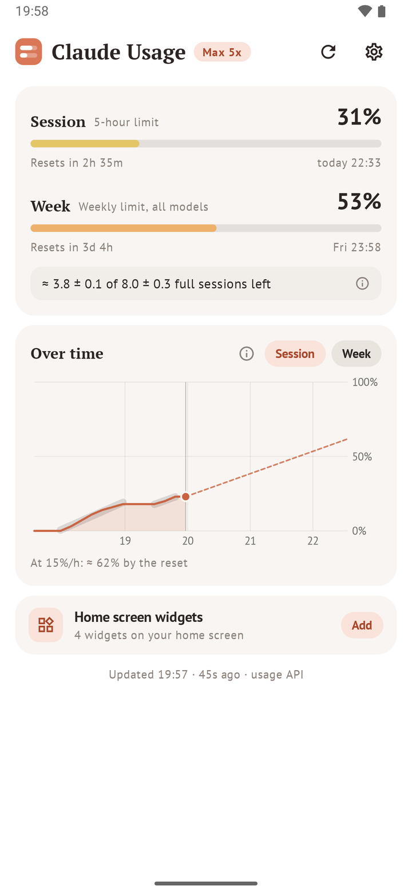
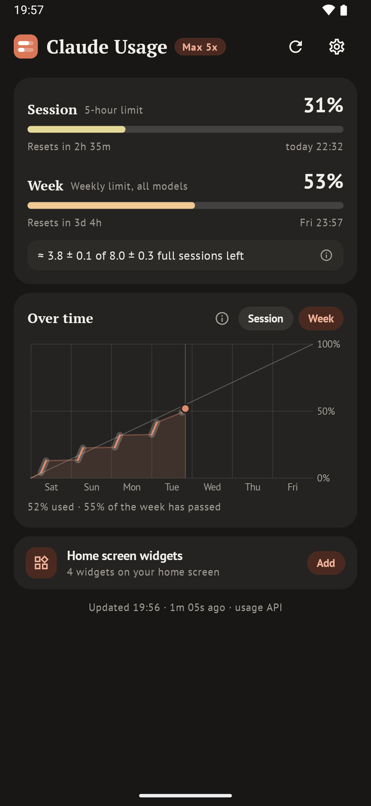
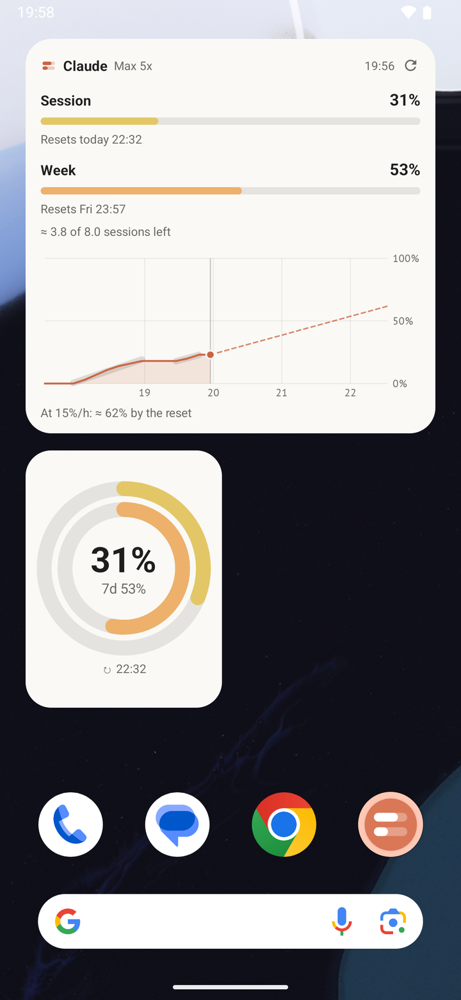
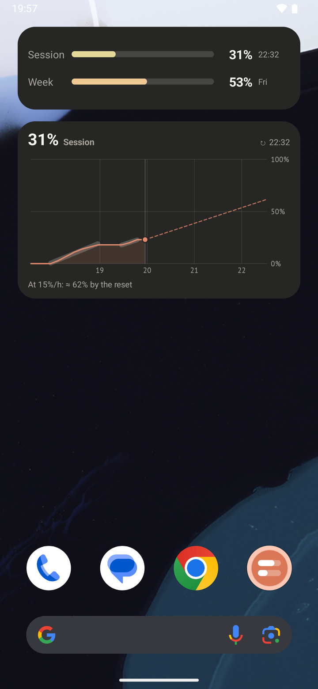
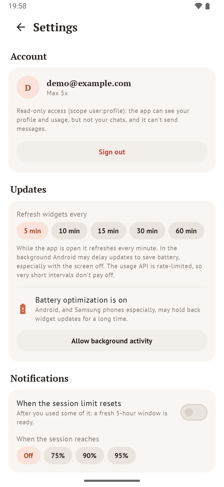

<div align="center">

# Claude Usage for Android

**Your Claude plan usage on your home screen: rings, bars and charts that keep themselves up to date.**

<a href="https://github.com/timofeykhodykin/android-claude-usage/releases"></a>


<a href="LICENSE.md"></a>

The Android companion of [Claude Usage for macOS](https://github.com/timofeykhodykin/mac-claude-usage).







</div>

> **Beta.** Works, but hasn't been tried on many phones and accounts yet. Issues are welcome.

## Features

- **Four widgets, any size.** Ring (from 1×1), Bars, Chart and Dashboard. Each one adapts its layout to the
  space it gets, from a single ring to bars, sessions left and a chart together.
- **Customizable.** Session, week or both; Claude's colors or your wallpaper's (Material You); bars colored by
  usage or in one accent; system, light or dark; background opacity; reset times; header with a refresh button;
  tap to open the app or to refresh. Long-press a widget to change it, with a live preview.
- **Follows the system theme** on its own, including the charts.
- **The app** shows what the macOS dropdown shows: session and weekly limits with reset times, other limits (per
  model), the usage chart with the pace of each stretch of use and where the current pace leads, and how many full
  5-hour sessions are left this week, learned from your own history.
- **Stays current.** Refreshes every minute while the app is open and on a schedule in the background (every 5 min by default, up to
  1 hour), redraws widgets the moment a limit resets, and marks numbers that have gone stale. Gentle on the
  rate-limited usage API, with exponential backoff.
- **Optional notifications** when the session limit resets, or reaches 75 / 90 / 95%.
- English and Russian.

## Sign-in and privacy

The Claude app keeps its sign-in in its private storage, which Android doesn't let other apps read, and a website
session cookie would grant full access to the account. So the app signs in on its own, the way Claude Code does
on a computer:

- **OAuth 2.0 with PKCE in your browser** (a Custom Tab, never a WebView): the app never sees your password, and an
  existing claude.ai session in the browser is reused. The browser returns to a one-shot server on `localhost`
  (bound to the loopback interface only, random port, checked `state`), or you paste the code it shows.
- **Read-only scope `user:profile`.** That's all `api/oauth/usage` needs: the token can read your profile and usage,
  but not your chats, and it can't send messages or use your plan.
- **Its own login.** It doesn't share tokens with Claude Code or the Claude app, so it never signs them out.
- **Encrypted at rest** with an AES-256-GCM key in the Android Keystore; stored in `no_backup`, with backups and
  device transfer turned off. Tokens are never logged.
- **Network:** HTTPS only, system certificate authorities only, and only `api.anthropic.com` and
  `platform.claude.com` (enforced in code). Signing out revokes the token and deletes everything.
- No analytics, no ads, no other servers.

## Install

Android 12 or later, and a Claude Pro, Max, Team or Enterprise plan.

Download the APK from the [releases](https://github.com/timofeykhodykin/android-claude-usage/releases) and
install it, or build it yourself (below). Open the app, sign in with
Claude, then add widgets from the app (Widgets → Add) or from the home screen's widget list.

On Samsung phones, allow background activity (Settings → Updates in the app has a button) so widgets aren't held
back for hours.

<details>
<summary><b>Build from source</b></summary>

<br>

Needs JDK 17 and the Android SDK (platform 37).

```bash
./gradlew :app:assembleDebug :app:testDebugUnitTest   # app/build/outputs/apk/debug/app-debug.apk
./gradlew :app:assembleRelease                        # signed with keystore.properties if present
```

</details>

## How it works

<details>
<summary><b>Where the numbers come from</b></summary>

<br>

`GET api.anthropic.com/api/oauth/usage`, the endpoint behind Claude Code's `/usage`. It's rate-limited hard
(about 30 calls in 15 minutes, then HTTP 429 for a long while), so every caller states how old the data may be,
refreshes never overlap, and after a 429 automatic refreshes back off exponentially up to 30 minutes.

Each change goes into a local history (percentages and reset times, kept 5 weeks), which drives the chart and the
sessions-left estimate: comparing how much the weekly and the 5-hour percentages grew in the same windows, with
recent sessions weighing more and data from before a change in the limits set aside. The math is the macOS app's,
ported with its tests.

</details>

<details>
<summary><b>Keeping widgets current</b></summary>

<br>

- Android runs periodic background work at most every 15 minutes, so shorter intervals use a chain of one-off jobs
  with the periodic job as a safety net. Background work runs only while there are widgets or notifications.
- Between fetches an alarm redraws the widgets when their content changes by itself: a limit resetting to 0%, or
  the data turning stale. Times are shown as clock times, so they never go out of date.
- Widgets render natively (RemoteViews) with charts drawn into bitmaps, in a day and a night variant that the
  launcher switches between itself. A widget's refresh button runs an expedited job and shows a spinner meanwhile.

</details>

## License

[PolyForm Noncommercial 1.0.0](LICENSE.md): free for personal and other noncommercial use.

Unofficial and not affiliated with Anthropic. Claude is a trademark of Anthropic, PBC.
